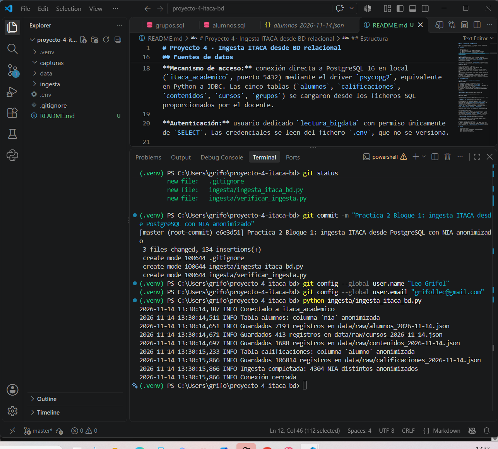
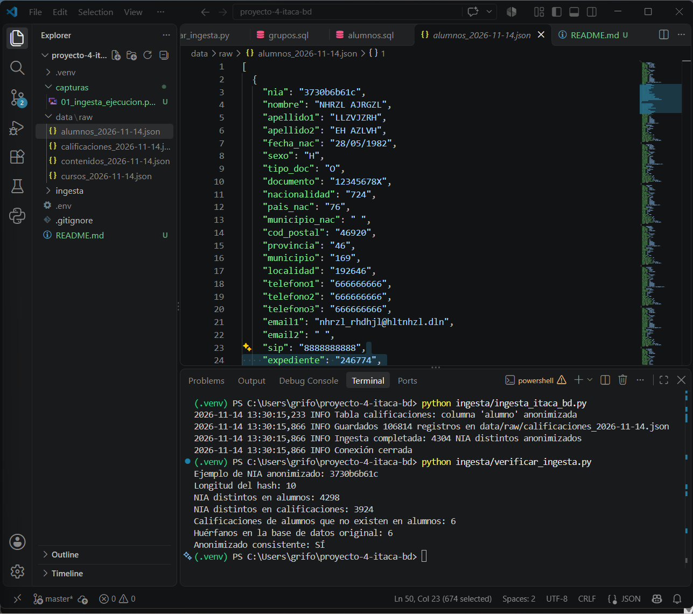
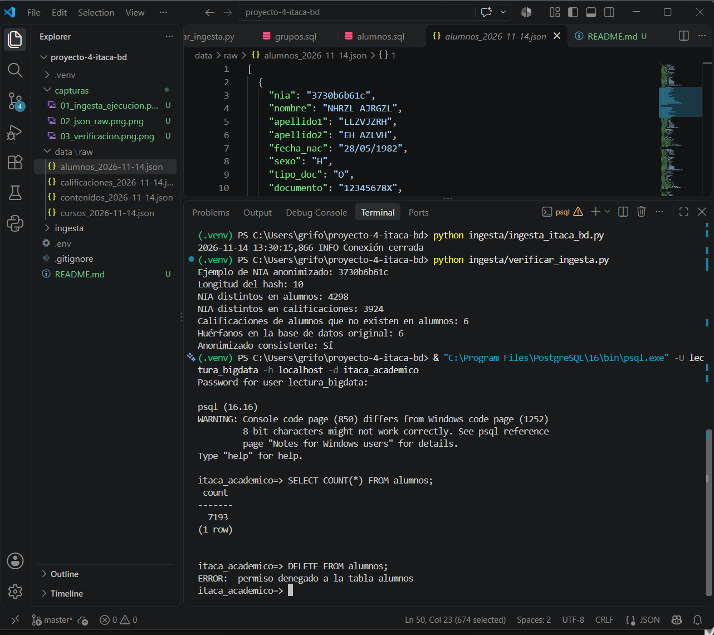
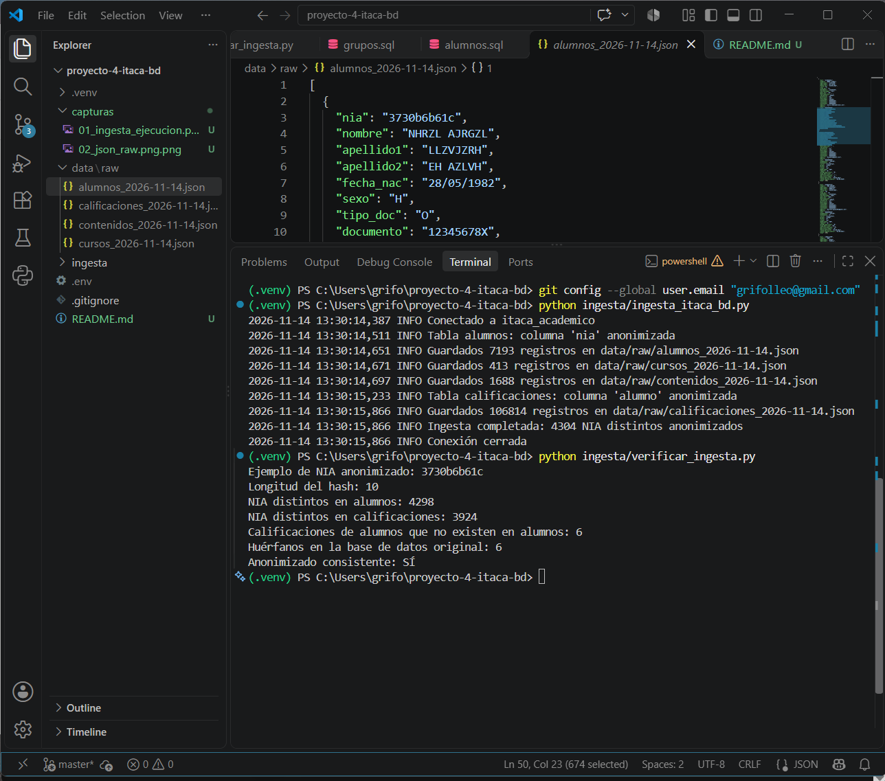

# Proyecto 2 · Ingesta ITACA desde BD relacional

Ingesta batch de datos académicos de ITACA desde PostgreSQL hacia la zona `raw` del proyecto, con anonimización del NIA.

## Estructura

    proyecto-2-itaca-bd/
    ├── ingesta/
    │   ├── ingesta_itaca_bd.py     # Script de ingesta
    │   └── verificar_ingesta.py    # Verificación de consistencia
    ├── capturas/                   # Evidencias de la práctica
    ├── data/raw/                   # Salida JSON (excluida de Git)
    ├── .env                        # Credenciales (excluido de Git)
    └── .gitignore

## Fuentes de datos

**Mecanismo de acceso:** conexión directa a PostgreSQL 16 en local (`itaca_academico`, puerto 5432) mediante el driver `psycopg2`, equivalente en Python a JDBC. Las cinco tablas (`alumnos`, `calificaciones`, `contenidos`, `cursos`, `grupos`) se cargaron desde los ficheros SQL proporcionados por el docente.

**Autenticación:** usuario dedicado `lectura_bigdata` con permiso únicamente de `SELECT`. Las credenciales se leen del fichero `.env`, que no se versiona.

**Campos por tabla:**

| Tabla | Campos principales | Registros |
|---|---|---|
| alumnos | nia, anyo, curso, grupo, turno, modalidad, repite, estado_matricula, fecha_matricula… | 7.193 |
| cursos | anyo, codigo, nombre_cas, nombre_val, abreviatura, ensenanza, padre | 413 |
| contenidos | anyo, codigo, nombre_cas, nombre_val, ensenanza, curso | 1.688 |
| calificaciones | anyo, evaluacion, alumno, curso, contenido, nota_numerica, tipo_nota | 106.814 |

**Frecuencia de actualización esperada:** las matrículas cambian sobre todo al inicio de curso y las calificaciones al cierre de cada evaluación. Se propone una ingesta programada semanal durante el curso y una extraordinaria tras cada sesión de evaluación.

## Bitácora de prácticas

### Bloque 1 · Práctica 2: Ingesta ITACA (BD relacional)

**Proceso seguido**

1. Instalación de PostgreSQL 16 en Windows y creación de la base `itaca_academico` con codificación UTF-8.
2. Carga de los cinco ficheros SQL con `\i` desde `psql`.
3. Creación del usuario de solo lectura `lectura_bigdata` y comprobación de permisos: puede consultar pero no modificar.
4. Desarrollo del script de ingesta: extrae las cuatro tablas, anonimiza el NIA y guarda cada tabla como JSON fechado en `data/raw/`.
5. Verificación de la consistencia del anonimizado contra la base de datos original.

**Resultado**

**Decisiones tomadas**

- **Usuario de solo lectura.** La ingesta nunca debe poder alterar la fuente. Comprobado: `DELETE` devuelve permiso denegado.

  

- **Anonimización del NIA con SHA-256 truncado a 10 caracteres.** Se usa un diccionario de caché para que un mismo NIA produzca siempre el mismo identificador. Se aplica a `alumnos.nia` y a `calificaciones.alumno`, que contienen el mismo dato, para conservar el cruce entre ambas tablas.

- **Nombres de tabla reales.** El esqueleto de la práctica menciona `modulos`, pero la base de datos proporcionada no contiene esa tabla; se extraen `alumnos`, `cursos`, `contenidos` y `calificaciones`.

- **Consultas parametrizadas con `psycopg2.sql.Identifier`** en lugar de construir el SQL con f-strings, como buena práctica frente a inyección SQL.

**Hallazgos de calidad del dato**

- La tabla `alumnos` tiene 7.193 filas pero 4.298 NIA distintos: un mismo alumno aparece una vez por cada año académico (`anyo`) en que se matriculó.
- Hay **6 NIA en `calificaciones` sin ficha en `alumnos`**. Se verificó en la base de datos original que estos huérfanos ya existían en la fuente; el anonimizado no rompe ningún cruce adicional.

  

- El resto de datos personales de la base de ejemplo (nombre, apellidos, email, documento, teléfonos) ya vienen enmascarados. En datos reales requerirían el mismo tratamiento que el NIA.

**Limitación conocida y mejora propuesta**

El NIA es un número de 8 cifras, por lo que un hash SHA-256 sin sal podría revertirse probando todas las combinaciones. La mejora sería añadir una sal secreta guardada en `.env` (`hashlib.sha256((SAL + nia).encode())`), de modo que el hash no se pueda reconstruir sin conocerla.

## Ejecución

    python -m venv .venv
    .venv\Scripts\activate
    python -m pip install psycopg2-binary python-dotenv pandas
    python ingesta/ingesta_itaca_bd.py
    python ingesta/verificar_ingesta.py
